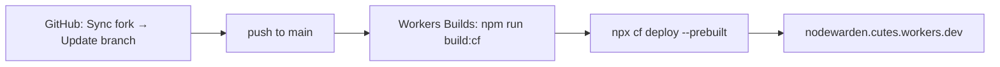

# Deploying this fork with the Cloudflare CLI (`cf`)

This fork (`Kutius/nw-vault`) is deployed with the **Cloudflare CLI (`cf`)**, not
Wrangler alone. This file records the operational details that are not obvious
from the upstream README, so the deployment can be reproduced or repaired
without rediscovering them.

Upstream's own flow (`npm run deploy` / Wrangler) still works and is untouched.

## TL;DR

```sh
npm ci
npm run deploy:cf        # build with Wrangler -> deploy with cf
```

Pushing to `main` also deploys automatically through Workers Builds.

## Why `cf deploy` is not called directly

`cf build` and `cf deploy` detect the project's build tool automatically. This
repository declares `vite` in the root `package.json`, so `cf` classifies the
project as a root-level Vite single-page app and runs `npx vite build` from the
repository root. That fails:

```txt
[UNRESOLVED_ENTRY] Cannot resolve entry module index.html.
```

The real frontend lives in `webapp/` and is built by `webapp/vite.config.ts` via
the `build` script, which `cf` does not run.

`cf migrate` therefore used the **Wrangler bundler**, and the deploy is split in
two steps:

| Step | Command | Purpose |
| --- | --- | --- |
| Build | `npm run build:cf` | `wrangler build --experimental-new-config --experimental-cf-build-output` produces Build Output in `.cloudflare/output/v0/` |
| Deploy | `npm run deploy:cf` | `cf deploy --prebuilt` uploads that Build Output |

`--prebuilt` skips `cf`'s build step, which is what avoids the misdetection.

### `build:cf` in detail

```sh
node scripts/check-cf-bindings.mjs \
  && node -e "require('node:fs').mkdirSync('dist',{recursive:true})" \
  && wrangler build --experimental-new-config --experimental-cf-build-output
```

- The guard runs first (see below).
- `dist/` must exist before `wrangler build`, because `wrangler.config.ts`
  declares `assetsDirectory: "./dist"`. A clean checkout has no `dist/`, and
  Wrangler fails with `The directory specified by the "assets.directory" field
  in your configuration file does not exist` instead of creating it.
- Both Wrangler flags are required. `--experimental-new-config` makes Wrangler
  read `cloudflare.config.ts`, and `--experimental-cf-build-output` emits the
  Build Output directory that `cf deploy --prebuilt` consumes.

## Binding parity guard

`cf deploy` reads **only** `cloudflare.config.ts`. It ignores `wrangler.toml`.
A binding, cron schedule, or Durable Object class added upstream to
`wrangler.toml` would therefore be **silently dropped** from the deployment:
the build succeeds, the deploy succeeds, and the binding is simply absent at
runtime.

`scripts/check-cf-bindings.mjs` compares `wrangler.toml` against
`cloudflare.config.ts` and fails the build on any missing name:

```txt
[check-cf-bindings] cloudflare.config.ts matches wrangler.toml (5 bindings, 1 cron, 2 Durable Object exports)
```

When it fails, add the reported item to `cloudflare.config.ts`:

| Reported as | Add to |
| --- | --- |
| missing binding | `worker.env`, using the matching `bindings.*` builder |
| missing cron | `worker.triggers`, using `triggers.scheduled({ schedule })` |
| missing Durable Object export | `worker.exports`, using `exports.durableObject({ storage })` |

Only `wrangler.toml` is compared. `wrangler.kv.toml` is the optional KV-mode
alternative and declares `ATTACHMENTS_KV`, which the R2-mode deployment
deliberately does not include. If you switch to KV mode, extend the guard.

## Configuration files

| File | Role |
| --- | --- |
| `cloudflare.config.ts` | The `cf` configuration. Source of truth for `cf` builds and deploys. |
| `wrangler.config.ts` | Wrangler build settings used by `wrangler build` (`build.command`, `assetsDirectory`). |
| `wrangler.toml` | Upstream's Wrangler config. Still used by `npm run dev` and `npm run deploy`. |
| `.cloudflare/` | Build Output, generated types. Gitignored. |

`cloudflare.config.ts` pins `accountId` and the D1 database `id` so deploys are
not ambiguous. `cf` accepts a D1 database by name, but the ID removes any doubt
about which account and database are targeted.

### Durable Object exports replaced migrations

Wrangler's ordered `migrations` history does not carry over to `cf`. Every
Durable Object class that is live is declared once in `worker.exports`:

```ts
exports: {
  NotificationsHub: exports.durableObject({ storage: "sqlite" }),
  BackupTransferRunner: exports.durableObject({ storage: "sqlite" }),
},
```

`storage: "sqlite"` matches the upstream `new_sqlite_classes` declarations.
Renames and deletions already applied upstream must not be copied here; they
would become stale tombstones.

## Provisioned resources

| Resource | Name / identifier |
| --- | --- |
| Worker | `nodewarden` |
| URL | `https://nodewarden.cutes.workers.dev` |
| D1 database | `nodewarden-db` |
| R2 bucket | `nodewarden-attachments` |
| Durable Objects | `NotificationsHub`, `BackupTransferRunner` |
| Cron trigger | `*/5 * * * *` |

`JWT_SECRET` is stored as a Worker **Secret** (not a plain-text variable), so
it survives redeployments. The application refuses to register accounts when it
is missing or shorter than 32 characters.

### Setting a secret

`cf` cannot create a secret on a Worker that does not exist yet, and a Worker
created by `cf deploy` gets its secrets from the version being deployed. Two
working paths:

```sh
# 1. With a deploy (first deploy or a rotation)
printf 'JWT_SECRET=%s\n' "$(node -e "console.log(require('crypto').randomBytes(48).toString('base64url'))")" > /tmp/secrets.env
npx cf deploy --prebuilt --secrets-file /tmp/secrets.env

# 2. On an existing Worker
cf workers secrets update JWT_SECRET --worker nodewarden --type secret_text --text "<value>"
```

`--type secret_text` is required; without it `cf` stops and asks for it.

## Automatic deployment (Workers Builds)

A GitHub connection and a build trigger are configured for this fork:

| Setting | Value |
| --- | --- |
| Repository connection | `Kutius/nw-vault` (provider `github`) |
| Trigger | branch `main` |
| Build command | `npm run build:cf` |
| Deploy command | `npx cf deploy --prebuilt` |
| Root directory | `/` |

Every push to `main` therefore builds and deploys. Verified end to end: a push
produced a `push_event` build that reached `success` and included the deploy
phase.

Inspect builds with:

```sh
cf workers scripts search                                        # get the Worker script tag
cf builds list --external-script-id <SCRIPT_TAG> --per-page 5
cf builds logs get <BUILD_UUID>
cf builds get <BUILD_UUID>
```

`--external-script-id` is the Worker's script tag, which is **not** the Worker
name. `cf workers scripts search` lists both.

> Some `cf` commands return values with a trailing carriage return on Windows.
> Strip `\r` before parsing JSON, or the API rejects the value as an invalid
> UUID.

## Updating from upstream



Either use the **Sync fork → Update branch** button on the fork's GitHub page,
or:

```sh
gh api repos/Kutius/nw-vault/merge-upstream -X POST -f branch=main
```

This is a merge, not a force-push, so the fork-only files listed above are
preserved. Upstream does not modify `cloudflare.config.ts`, `wrangler.config.ts`,
or `scripts/check-cf-bindings.mjs`.

After syncing, the guard fails the build if upstream added a binding. Add the
reported entries to `cloudflare.config.ts`, commit, and push.

### Database schema

No manual migration step is needed. `initializeDatabase()` compares a stored
schema version on each request and, when it differs, runs the idempotent schema
statements (`CREATE TABLE IF NOT EXISTS`, `ALTER TABLE ... ADD COLUMN`).
Existing data in D1 is preserved. The first request after an upgrade performs
the migration, so visit the site once after syncing.

## Local development

```sh
npm run dev              # wrangler dev -c wrangler.toml  (R2 mode)
npm run dev:kv           # wrangler dev -c wrangler.kv.toml
npm run dev:demo         # webapp dev server, demo mode
```

`cf dev` is not usable in this repository for the same reason `cf build` is:
`cf` detects the root `vite` dependency and runs the wrong dev server, which
returns `404` responses.

## Not supported by `cf` yet

- **Live logs**: run `npx wrangler tail nodewarden`.
- **Single-secret updates during a build**: use `cf workers secrets update` on
  an existing Worker, or `--secrets-file` with a deploy.

## Custom domain

The deployment currently uses the `*.workers.dev` subdomain. The Cloudflare
account has no zones, so a custom domain requires adding the domain's zone to
that account first, then either adding `worker.domains` to
`cloudflare.config.ts` or running `cf workers triggers deploy`.
